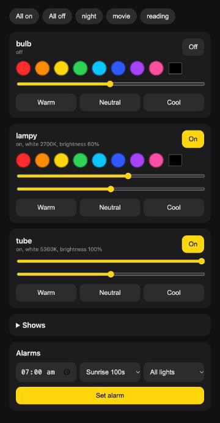

# lights

Control Tuya and Xiaomi smart lights from your terminal and your phone. No cloud, no hub, no account.

```
$ lights tube sunrise at 7:00     # wake up gently: 1% to 100% over 100 s
$ lights lampy orange             # one light, by colour name
$ lights bulb,lampy 30            # several lights, brightness 30%
$ lights party 30s                # random colours, then everything is put back
$ lights tube off in 45m          # a sleep timer; also: at 22:30
$ lights serve                    # a page like this for your phone
```



- **Local.** Commands go straight to the lights over your Wi-Fi, so it works when the internet is down.
- **One tool for different brands.** Tuya / Smart Life lights (Wipro and many others, including white-only tubelights) and the Xiaomi Mi Bedside Lamp 2 (Yeelight protocol over miIO).
- **Timers.** Add `in 25m` or `at 22:30` to any command, and it runs later. Sleep timers, wake-up alarms, and a pomodoro: `lights lampy red && lights lampy green in 25m && lights lampy red in 30m` is red to focus, green for the break, red again.
- **Phone page.** Colours, brightness, warmth, a sunrise button and one-off alarms. Put it behind your own tunnel to use it away from home.
- **Small.** Plain Python, no framework. Or paste one prompt into Claude Code and let it do the setup.
- Also: an optional light that shows what Claude Code is doing.

## Quick start with Claude Code

Paste this into Claude Code. It does the whole setup, asks before changing any settings, and
never prints your keys or tokens:

> Set up https://github.com/lokeshdevnani/lights for me. Clone it, read `SETUP.md`, and follow it step by step. Ask me before changing any settings.

## Manual setup

Needs Python 3.11+.

```sh
python3 -m venv .venv && .venv/bin/pip install -r requirements.txt
cp devices.example.toml devices.toml    # then fill it in, see below
```

Put a wrapper on your PATH so you can type `lights`:

```sh
mkdir -p ~/.local/bin
for n in lights lights-status; do
  printf '#!/bin/sh\nexec %s/.venv/bin/python %s/%s "$@"\n' "$PWD" "$PWD" "$n" > ~/.local/bin/$n
  chmod +x ~/.local/bin/$n
done
```

### devices.toml

One `[devices.NAME]` section per light. See `devices.example.toml`. The file holds secrets
and is gitignored.

**Tuya / Smart Life light**: needs the device ID, LAN IP and *local key*.
- ID and IP: `.venv/bin/python -m tinytuya scan` lists Tuya lights on your network.
- Local key: a QR login through the Smart Life app works without a Tuya cloud project, for
  example [tuya-local-key](https://github.com/vineetchoudhary/tuya-local-key).

**Tuya white-only light** (e.g. a Wipro tubelight): same ID, IP and key as above, but use
`type = "tuya-white"` and the version `tinytuya scan` reports. It supports on/off, brightness and
warm/neutral/cool (or kelvin). If the QR login rejects the vendor's own app (Wipro), re-pair the
light in Smart Life first.

**Mi Bedside Lamp 2**: needs the lamp's IP, numeric device ID (`did`) and token. Get the token with
[Xiaomi-cloud-tokens-extractor](https://github.com/PiotrMachowski/Xiaomi-cloud-tokens-extractor)
using QR login. Leave its server prompt empty to check every region, because the lamp may be on
a region other than your own (here it was `i2`).

## Usage

```
lights [LIGHT[,LIGHT...]] [COMMAND]
```

No light name means **all lights**. A name (or comma-separated names) means just those. Lights
that cannot do a command are skipped, for example a colour on a white-only light.

| Command | Meaning |
|---|---|
| `lights` | show every light (same as `status`) |
| `on`, `off`, `toggle` | power |
| `orange`, `#ff8800` | colour by name or hex (red green blue yellow orange purple pink cyan) |
| `30`, `30%` | brightness 1-100 |
| `sunrise [DURATION]` | wake-up ramp: warm white from 1% to 100% in 100 s (or e.g. `5m`); `lights tube sunrise at 7:00`. Ctrl-C leaves the light as it is |
| `warmth 0-100` | warm-to-cool on a percentage scale, 100 = warmest (only where supported) |
| `warm`, `neutral`, `cool`, `3000k` | white temperature (only where supported, e.g. the Mi lamp, 1700-6500 K) |
| `white` | plain white mode |
| `party [30s]` | random vivid colours on every light (or the named ones) until Ctrl-C, or for the given time; the lights go back to how they were afterwards |
| `fix-ip` | re-find lights whose IP changed and update `devices.toml`; lights that still respond are left alone |
| `list` | configured lights |

### Party mode

```
lights party            # all lights, until Ctrl-C
lights lampy party 2m   # one light, for two minutes
```

Lights that cannot show colours are skipped. A scheduled party needs a length:
`lights party 2m in 10m`.

### Run a command later

Add `in` or `at` to the end of any command:

```
lights lampy red in 30s          # in 30 seconds (units: s, m, h; 1h30m works)
lights off in 30m                # sleep timer for every light
lights bulb,lampy warm at 22:30  # at a clock time (24-hour; tomorrow if already past)
lights timers                    # list what is scheduled
lights cancel                    # cancel everything, or `lights cancel ID`
```

Timers run in a detached background process, so they survive closing the terminal. If your
computer sleeps past the time, the command runs when it wakes. Errors go to
`~/.cache/lights-timers/error.log`.

Long forms also work: `color NAME|#RRGGBB|R G B`, `brightness N`, `white [KELVIN]`.
Light names cannot clash with commands or colour names (`devices.toml` is checked on load).

## Control from your phone

```bash
lights serve          # then open http://<your-mac-ip>:8080 on your phone
```

Add the page to your home screen. You get on/off, colours, brightness, warm/cool and party buttons for every light.

For a bare-minimum password, add `server_key = "something"` at the top of `devices.toml` and open `http://<your-mac-ip>:8080/?key=something`. It is only a shared word in the address, not real security. The lights only talk on your home network, so the Mac running `lights serve` must be awake. To reach it away from home, put a tunnel in front of port 8080 (Cloudflare Tunnel or Tailscale), ideally one that adds its own login.

## Claude Code status light

`lights-status` shows what Claude Code is doing on one light (`status_device` in `devices.toml`):

| Event | Light |
|---|---|
| prompt submitted | blue |
| waiting for you (permission prompt) | orange |
| finished | green for 8 s, then the light returns to how it was |

It saves the light's state first and restores it afterwards. If you change the light yourself in
the meantime, your change is kept. It does nothing if the light is off or unreachable and returns
immediately, so it never slows Claude down.

Add these hooks to `~/.claude/settings.json` (merge them into any existing `hooks` object):

```json
"hooks": {
  "UserPromptSubmit": [{ "hooks": [{ "type": "command", "command": "~/.local/bin/lights-status working", "timeout": 5 }] }],
  "Notification":     [{ "hooks": [{ "type": "command", "command": "~/.local/bin/lights-status needs-you", "timeout": 5 }] }],
  "Stop":             [{ "hooks": [{ "type": "command", "command": "~/.local/bin/lights-status done", "timeout": 5 }] }]
}
```

Then run `/hooks` or start a new session. Mute it with `lights-status off`, re-enable with
`lights-status on`, and check with `lights-status state`. Errors go to
`~/.cache/lights-status/error.log`.

## Adding another kind of light

A backend is one small class in `lightsctl/` that subclasses `Light` (`lightsctl/base.py`):
`on`, `off`, `color`, `brightness`, `white`, `status`, `snapshot`/`restore`/`fingerprint`
(for the status light) and `find_ip`. Register it in `config.make`.

## Tests

```sh
.venv/bin/python -m unittest discover -s tests -t .
```

## Troubleshooting

- **"Unable to Connect" or timeouts on a Tuya light:** it accepts one local connection at a time.
  Close the Smart Life app and retry.
- **A light moved IP:** `lights fix-ip`.
- **Decrypt errors on a Tuya light:** the local key changed (re-pairing or resetting does this). Fetch the new key.
- **Light not found:** Tuya and Mi lights only support 2.4 GHz Wi-Fi; your computer must be on the same network.

## License

MIT, see [LICENSE](LICENSE).
